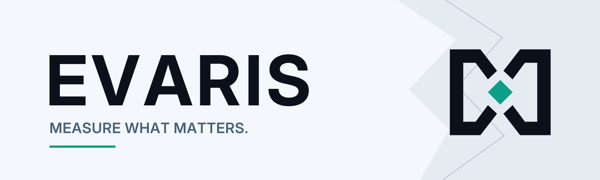

# Evaris

A standalone, open-source Agent & Skill Evaluation Framework written in Go.

Evaris aims to evaluate engineering outcomes through reproducible experiments,
deterministic checks, independent review, and transparent evidence.

## Status

Version 0.4.0 is the current release. It adds single-arm acceptance mode,
glob `allowedChanges` with `protectedPaths`, import from a Git commit, frozen
reviewer files, per-criterion results in reports and `evaris show`, command
`dependencies` and `limits.maxEntries`, and Invaris campaign verification with
support for Invaris v0.3.0 through 0.5.x. See the [changelog](CHANGELOG.md).
0.3.0 added `snapshotExclude` and step-naming failure messages; 0.2.0 added a runbook for evaluating real external
agents ([pilot.md](docs/pilot.md)). Evaris supports experiment
validation, blind preparation, and external-result import:

```sh
go run ./cmd/evaris validate --experiment testdata/valid/experiment.json
```

Preparation and import are implemented with frozen inputs and integrity checks.
The release also provides deterministic grading, immutable evaluations, JSON/Markdown
reports, and an offline control demonstration. P1 adds optional verification
through an external Invaris CLI ([invaris.md](docs/invaris.md)) and baseline and
revision comparisons ([comparison.md](docs/comparison.md)). Linux and macOS are
supported; Windows is not. See [releases and support](docs/release.md),
[workflow](docs/workflow.md), [pilot runbook](docs/pilot.md), [configuration](docs/configuration.md) and the
[verification status](docs/p0-readiness.md).

## npm distribution

The npm package is prepared for publication as `evaris-cli` from
[refactorroom/evaris](https://github.com/refactorroom/evaris). Once published,
Node.js 18 or newer can run the latest release with:

```sh
npx evaris-cli@latest --version
npm install -g evaris-cli@latest  # install or update globally
evaris --help
```

For a project dependency, use `npm install --save-dev evaris-cli@latest`.
The unscoped `evaris` npm name belongs to a different package. npm manages the
installation; Evaris does not provide an `update` subcommand. The package bundles
Linux and macOS binaries for x64 and arm64 and does not download binaries at run
time. Preserve evidence when changing versions; older binaries may reject records
written by newer releases. Pin an earlier npm version to roll back.

## Build and verify

```sh
go install github.com/akkaraponph/evaris/cmd/evaris@v0.4.0
evaris --version

mkdir -p .panda-suite/build                # or build from a checkout
go build -o .panda-suite/build/evaris ./cmd/evaris
.panda-suite/build/evaris --help
go test -race ./...
go vet ./...
```

The six commands are `validate`, `prepare`, `import`, `evaluate`, `report`, and
`compare`. `evaluate --store DIR --run ID` publishes a fresh immutable evaluation;
add `--allow-commands` only for trusted command graders, and `--invaris PATH` for
cases that configure Invaris verification. `report --store DIR` creates JSON and
Markdown files under the printed report ID. `compare --left DIR --right DIR
--mode arms|revisions` records whether conditions matched and, only then, the
observed transitions. Exits are 0 for PASS (or no observed regression), 1 for a
known FAIL (or an observed comparable regression), and 2 for incomplete evidence,
non-comparable inputs or operation errors.

Run the [offline controls](examples/offline/README.md) to observe both ordinary
suites pass while the independent acceptance grader rejects the bad control.
No model API is needed; synthetic controls are not measurements of agent quality.

## Intended scope

The first release is intended to validate experiment definitions, prepare separate
case workspaces, import real results from externally run agents, apply deterministic
graders, and write JSON and Markdown reports. It should work offline without an
LLM API, using JSON configuration and filesystem artifacts.

P1 adds baseline and revision comparisons, regression observations, and optional
Invaris CLI integration. Panda Suite is a prospective consumer, not a required
dependency. An Invaris verification verdict remains separate from the Evaris
assessment of whether an agent completed its task: Invaris ACCEPT never replaces
a failed or missing Evaris criterion.

## Architecture

Use a small Go CLI with hexagonal boundaries and the standard library first.
The following paths describe ownership in the current implementation:

| Area | Path | Responsibility |
| --- | --- | --- |
| Composition | `cmd/evaris/` | Wire dependencies and translate process exit status |
| Domain | `internal/domain/` | Experiment, run, evaluation and comparison rules |
| Application | `internal/application/` | Lifecycle: validate, prepare, import, evaluate, report, compare |
| Adapters | `internal/adapters/` | CLI, strict JSON and filesystem evidence, graders, processes, renderers, Invaris CLI client |

Dependencies point inward: adapters depend on application and domain code;
application code depends on domain code. Domain code must not depend on CLI,
filesystem, or process execution details. Define small ports at the consuming
boundary when a real external operation requires one; avoid speculative plugin
interfaces and empty packages. Keep wiring in the composition entry point.

Ordinary workspace directories are not security sandboxes. Imported agent claims
are evidence to verify, not proof of success. Keep reviewer oracles out of agent
workspaces and distinguish infrastructure errors from agent task failures.

## Development

Use Go 1.27.4 or newer, preferably the latest stable patch of a supported release.
The minimum is recorded in `go.mod`; no third-party dependencies are declared.
See the official [Go downloads](https://go.dev/dl/) and
[module reference](https://go.dev/doc/modules/gomod-ref).

From the repository root, inspect the module:

```sh
go version
go mod edit -json
go mod verify
```

Run `go build ./...`, `go vet ./...`, and `go test -race ./...` to check the
current implementation. Passing these checks does not establish complete MVP
acceptance; see [P0 verification status](docs/p0-readiness.md).

## Local artifacts

The default example writes private evidence to `testdata/valid/evidence/`.
`.gitignore` excludes that directory, root `evidence/`, `tasks/`, `.evaris/`,
`bin/`, `dist/`, coverage output, local environment files, and `.panda-suite/`.
Source, original fixtures, reviewer control files, documentation, and branding
assets remain versioned. Configuration examples such as `.env.example` stay trackable.

If you configure another evidence or workspace location inside this repository,
add its exact path to `.gitignore` before running evaluations. A custom outputRoot
is not automatically ignored. Keep real responses, transcripts, and private grader
oracles out of commits; the checked-in reviewer fixture is synthetic test data.

## Contributing and security

See [CONTRIBUTING.md](CONTRIBUTING.md) for contribution expectations and
[SECURITY.md](SECURITY.md) for vulnerability reporting.

## License

Licensed under the [Apache License, Version 2.0](LICENSE).
